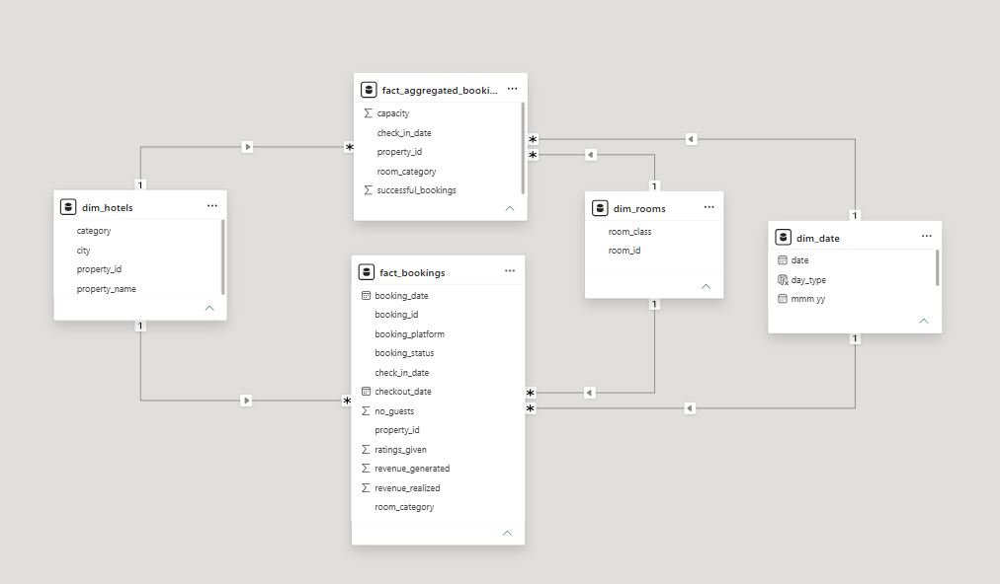
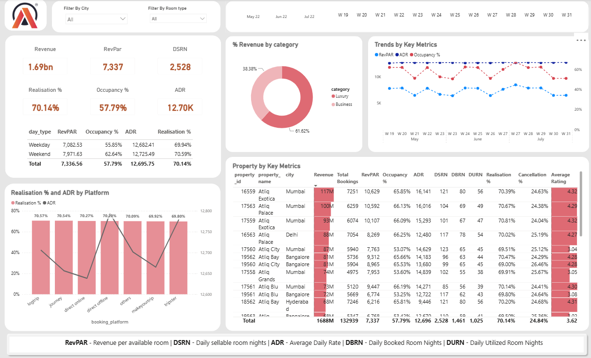

# 🏨 AtliQ Grands — Hospitality Revenue Analysis Dashboard

## 📌 Project Overview

AtliQ Grands is a luxury hotel chain operating across India with over 20 years of experience in the hospitality industry. Due to increasing competition and ineffective decision-making, the company has been experiencing a decline in market share and revenue.

This project uses **Power BI and data analytics** to transform hotel booking and revenue data into actionable business insights, helping stakeholders monitor performance, identify revenue opportunities, and make data-driven decisions.

## 🎯 Project Objectives

- Develop an interactive Power BI dashboard to monitor hotel performance.
- Create key hospitality KPIs using DAX measures.
- Analyze revenue, occupancy, booking trends, and customer behavior.
- Identify underperforming properties and opportunities for improvement.
- Provide strategic recommendations to improve revenue and market share.

## 🛠️ Tools & Technologies

- **Power BI** — Interactive dashboards and data visualization
- **Power Query** — Data cleaning and transformation
- **DAX** — KPI calculations and business metrics
- **Data Modeling** — Relationships between fact and dimension tables
- **Excel / CSV** — Data source and preliminary exploration

## 📊 Key Performance Indicators (KPIs)

| KPI | Description |
|---|---|
| Revenue | Total revenue generated from hotel bookings |
| ADR | Average Daily Rate for rooms sold |
| RevPAR | Revenue Per Available Room |
| Occupancy % | Percentage of available rooms occupied |
| DBRN | Daily Booked Room Nights |
| DSRN | Daily Sellable Room Nights |
| DURN | Daily Utilized Room Nights |
| Realization % | Percentage of bookings successfully realized |
| Cancellation % | Percentage of bookings cancelled |
| No-Show Rate | Percentage of bookings where guests did not arrive |

**Note:** Friday and Saturday are considered weekend days in this analysis.

## 🔄 Project Workflow

1. **Data Collection** — Imported the provided hospitality datasets into Power BI.
2. **Data Exploration** — Examined booking records, hotel properties, room categories, and revenue data.
3. **Data Cleaning & Transformation** — Used Power Query to prepare data for analysis.
4. **Data Modeling** — Established relationships between relevant tables.
5. **DAX Measures** — Created measures to calculate hospitality KPIs.
6. **Dashboard Development** — Designed interactive visualizations based on stakeholder requirements.
7. **Business Insights** — Analyzed performance trends and identified opportunities for improvement.

## 📈 Dashboard Screenshots

### 1. Data Model View

### 2. Dashboard Overview

## 💡 Business Insights & Recommendations

The dashboard supports hotel management in identifying performance gaps and exploring strategies to improve business outcomes.

### Recommended Business Strategies

- **Dynamic Pricing:** Adjust room prices based on demand, seasonality, and weekday versus weekend trends.
- **Rate Parity:** Maintain consistent pricing across booking channels while accounting for channel-specific costs and agreements.
- **Promote Direct Bookings:** Encourage customers to book through official hotel channels to reduce dependence on third-party platforms.
- **Weekend Campaigns:** Introduce targeted offers to improve weekend occupancy.
- **Customer Segmentation:** Develop tailored pricing and promotions for business and leisure travelers.
- **Cancellation Analysis:** Investigate cancellation patterns to identify potential issues with pricing, booking policies, or customer experience.

## 📌 Business Impact

This dashboard provides stakeholders with a consolidated view of hotel performance and enables them to:

- Monitor revenue and occupancy KPIs.
- Compare performance across properties and booking periods.
- Identify underperforming hotels and potential revenue opportunities.
- Support pricing, marketing, and booking-channel decisions.
- Make informed, data-driven business decisions.

## 🚀 Skills Demonstrated

- Data Cleaning and Transformation
- Data Modeling
- DAX Measures and KPI Development
- Interactive Dashboard Design
- Business Intelligence and Data Visualization
- Hospitality Revenue Analysis
- Analytical Thinking and Business Recommendations

*This project demonstrates how business intelligence and data visualization can support strategic decision-making in the hospitality industry.*
